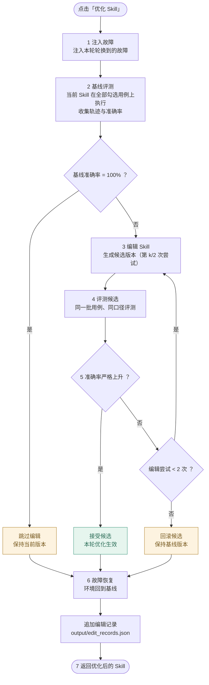

# Skill Studio

## 启动

在已安装依赖的 Python 环境中运行：

```sh
python app.py
```

页面和后端一起启动。本机打开 http://127.0.0.1:8000 ，同一局域网的设备打开 `http://这台电脑的IP:8000`。

第一次使用、尚未安装依赖时：

```sh
pip install --no-compile -r requirements.txt
```

## 接入你的生成 / 优化函数

在 `net_skill/dcn_opencode/pipeline.py` 顶部的接入区替换两个函数（同步或 `async` 均可，返回完整 Markdown 字符串）：

- `generate_skill(intent, skill_id)` — 点击「生成 Skill」时调用：读取 `net_skill/skills/` 下界面选中的待优化 Skill 的 `SKILL.md` 作为初始版本 V0；未指定或不存在时取第一个，没有待优化 Skill 时按意图生成占位版本。
- `optimize_skill(intent, skill, round_number)` — 点击「优化 Skill」时调用；`skill` 是当前最新版本内容，`round_number` 从 1 开始，每点击一次加一；`case_ids` 是界面勾选的训练用例 id，为空时每轮在全部用例中轮换。当前接入 `net_skill/state_machine.py` 的评测驱动状态机：基线评测（全部勾选用例的准确率与轨迹）→ 编辑候选 → 评测候选 → 准确率严格上升才接受，否则回滚并重新编辑（上限 2 次），仍无提升保持基线版本。
  - 逐阶段写法（推荐）：改成生成器，按 `OPTIMIZE_STEPS` 的序号逐阶段 `yield {"step": 1, "status": "running", "content": "可选说明"}`，每个阶段先 running、结束时再 completed（回滚重试时同一阶段可重复 running→completed）；界面会实时显示各阶段进度（优化中…），全部结束后再 `yield` 优化后的完整 Markdown 字符串。
  - 整体写法：普通函数 / 协程直接返回完整 Markdown，界面只显示「优化中」，完成后展示新版本。

## 优化状态机

每点击一次「优化 Skill」，运行一个完整的评测驱动循环（`net_skill/dcn_opencode/state_machine.py`）：



- 接受标准：候选准确率**严格上升**才接受；相等或下降一律回滚，回滚后以基线版本为输入重新编辑（上限 2 次尝试），仍无提升则保持基线版本。
- 每轮结果（含每次编辑的 `applied` / `rolled_back` 状态与准确率变化）追加写入 `output/edit_records.json`，可在「Skill 编辑记录」面板查看。
- 未配置大模型凭证时，第 1 次编辑尝试是演练设定的弱草稿（不含根因，必然回滚），用于确定性演示回滚路径；接入火山方舟大模型后由真实输出交评测器裁决。

## 文件

- `web/`：UI 界面代码（`index.html`、`styles.css`、`config.js`、`src/`）。
- `net_skill/`：Skill 生成与优化逻辑，按领域分包，与 `web/` 同级。`dcn_opencode/` 是 DCN 领域的完整实现：`pipeline.py` 是接入入口，`state_machine.py` 是评测驱动的优化状态机（准确率严格上升才接受，否则回滚重编辑，结果写入项目根 `output/edit_records.json`），`mock_optimizer/` 提供演练故障环境与评测 Agent，`skill_editor/` 是轨迹驱动的编辑 agent（输入运维轨迹：用了哪个 Skill、调了哪些工具、结果对错；优先接火山方舟大模型编辑，需设置 `ARK_API_KEY`、`SKILL_LLM_MODEL` 环境变量，详见该模块 docstring，未配置或失败时自动回退规则编辑），`data/train_data.json` 是训练集（`question` 故障现象、`gold_answer` 期望根因、`inject_intent` / `inject_device` 注入操作与设备，优化轮次按轮换使用），`skills/` 下放待优化的 Skill（生成阶段作为 V0 读入）；另有对接真实评测平台与 opencode 服务的闭环模块（`dcn_pipeline.py` 编排、`polaris_client.py` 评测平台客户端、`eval_parse.py` 结果解析、`upload_skill_dcn.py` Skill 同步、`skill_edit.py` 编辑、`prompts/` 分析 prompt、`run_dcn_optimize_loop.sh` 启动入口；外部服务用环境变量配置，未配置时自动降级到本机演练路径，配置说明见各模块 docstring）。`ci_hummingbrid/` 是 CI 领域（待接入，结构可参照 dcn_opencode）。
- `app.py`：FastAPI 服务入口，托管 `web/` 界面并调用 `net_skill/` 的逻辑；`storage.py` 是历史记录存储。
- `CHANGELOG.md`：每次修改的更新日志。
- `history/`：每次生成一个文件夹，保存意图、事件流和各版本 `.md`。
- 页面可以选择待优化 Skill（`GET /api/skills/catalog` 列出，默认选最近生成用过的）、勾选优化用例（`GET /api/skills/cases` 列出，优化请求带 `cases`，只对勾选的用例做定向优化），查看历史、切换版本、下载 Skill，以及确认后删除记录；底部「准确率曲线」面板支持手动录入每轮优化的准确率并绘制折线图，也可导入 Excel（.xlsx）/ CSV 自动识别「轮次、准确率」两列（数据保存在浏览器本地）；「Skill 编辑记录」面板读取 `output/edit_records.json`（`GET /api/skills/edit-records`），按轮次查看每条编辑的操作、状态与内容。

关闭页面不会停止后台任务；关闭后端会停止执行，但已保存的记录仍保留。
